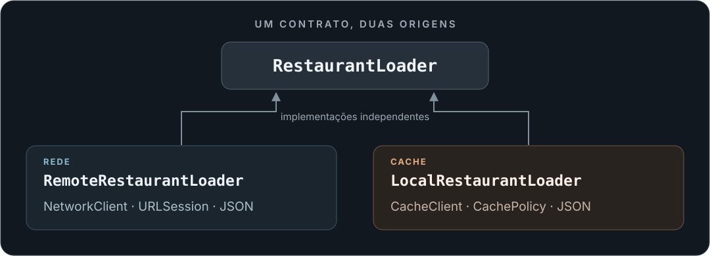

<h1 align="center">RestaurantDelivery</h1>

<p align="center">
  <strong>Carregamento de restaurantes, da rede ao cache.</strong><br>
  Um estudo em Swift sobre contratos, persistência e comportamento testável.
</p>

<p align="center"><sub>Swift · Foundation · URLSession · UIKit · XCTest</sub></p>

<p align="center">
  <a href="#visão-geral">Visão geral</a> &nbsp; · &nbsp;
  <a href="#começar">Começar</a> &nbsp; · &nbsp;
  <a href="#testes">Testes</a> &nbsp; · &nbsp;
  <a href="#explorar-o-código">Explorar o código</a>
</p>

<p align="center">
  
</p>

## Visão geral

O projeto explora duas formas de carregar uma coleção de restaurantes sob o mesmo contrato: uma resposta HTTP e um cache local. As dependências de rede, armazenamento e tempo são injetadas para permitir testes com resultados controlados.

**Rede.** O `RemoteRestaurantLoader` recebe uma URL e um `NetworkClient`. Aceita HTTP 200 com JSON válido no formato `{ "items": [...] }` e distingue falha de conectividade de dados inválidos. O `NetworkService` implementa o cliente usando `URLSession`.

**Cache.** O `LocalRestaurantLoader` carrega, salva e valida dados por meio de `CacheClient`. O `CacheService` persiste os itens e o timestamp em JSON num arquivo. A política padrão considera o cache válido até antes de completar um dia de calendário; o relógio é injetável.

**Interface.** O `RestaurantListViewController` recebe um `RestaurantLoader`, solicita dados ao carregar a view e oferece pull to refresh com indicador de carregamento. A coleção recebida é armazenada no controller; a renderização dos restaurantes nas células ainda está pendente.

> O repositório contém **frameworks e testes**, sem um target de aplicativo executável. Os loaders local e remoto são implementações separadas: não há fallback automático de rede para cache nem composição completa de um app de delivery.

## Começar

1. Clone o repositório:

   ```sh
   git clone https://github.com/guilhermepratac/RestaurantDelivery.git
   cd RestaurantDelivery
   ```

2. Abra `RestaurantDomain.xcodeproj` no Xcode.
3. Selecione o scheme compartilhado **RestaurantDomain** para explorar o domínio e seus testes. Como ele gera um framework, use **Test** (`⌘U`) para executar os testes; não há app para abrir com **Run**.

O projeto está configurado em modo Swift 5.0. O código contém sintaxe que requer compilador Swift 5.7 ou posterior. Os frameworks declaram iOS 13; o domínio também está configurado para macOS, com deployment target macOS 13.1. O target `RestaurantUITests` declara iOS 16.4.

Os fontes não importam bibliotecas de terceiros, e não há manifesto de Swift Package Manager ou CocoaPods no repositório.

## Testes

Os cenários existentes exercitam contratos e respostas com spies, sem depender de uma API de restaurantes em produção:

| Área | Cenários presentes |
| --- | --- |
| Rede | URL requisitada, execução da tarefa, conectividade, HTTP inválido, JSON inválido e lista vazia ou preenchida. |
| Cache | Salvar e substituir dados, apagar, recuperar conteúdo, lidar com dados inválidos e validar expiração com tempo controlado. |
| Interface | Carregamento inicial, pull to refresh, atualização da coleção e término do indicador após sucesso ou erro. |

Apesar do nome, `RestaurantUITests` contém **testes unitários do controller com XCTest**, não automação de ponta a ponta com XCUITest. Os schemes compartilhados `RestaurantDomain` e `RestaurantDomainTests` incluem a suíte do domínio; não incluem `RestaurantUITests`.

<details>
<summary><strong>Comando de referência para os testes do domínio</strong></summary>

No macOS, com o Xcode selecionado como ferramenta de desenvolvimento:

```sh
xcodebuild -project RestaurantDomain.xcodeproj \
  -scheme RestaurantDomain \
  -destination 'platform=macOS' \
  CODE_SIGNING_ALLOWED=NO test
```

Esse comando se destina aos testes do domínio, sem UIKit. Ele não valida a interface iOS.

</details>

**Estado de validação:** esta curadoria não executou build ou testes do projeto. Na leitura dos fontes, `RemoteRestaurantLoaderTests` ainda referencia `RestaurantLoaderResult`, enquanto o contrato atual define `RestaurantResult`; essa divergência precisa ser resolvida antes de considerar a suíte pronta. O comando acima documenta a configuração pretendida, sem afirmar que a suíte passa.

## Explorar o código

- [Contrato de carregamento](RestaurantDomain/RestaurantLoader.swift) — resultado compartilhado pelos loaders.
- [Modelo de restaurante](RestaurantDomain/RestaurantItem.swift) — estrutura `Codable` e `Equatable`.
- [Loader remoto](RestaurantDomain/RemoteLoader/RemoteRestaurantLoader.swift) e [cliente de rede](RestaurantDomain/RemoteLoader/NetworkClient.swift).
- [Loader local](RestaurantDomain/LocalLoader/LocalRestaurantLoader.swift), [armazenamento](RestaurantDomain/LocalLoader/Cache/CacheClient.swift) e [política de validade](RestaurantDomain/LocalLoader/RestaurantLoaderCachePolicy.swift).
- [Controller UIKit](RestaurantUI/RestaurantListViewController.swift) e [seus testes](RestaurantUITests/RestaurantUITests.swift).
- [Testes do domínio](RestaurantDomainTests) — cenários de rede e cache.

<details>
<summary><strong>Estrutura do repositório</strong></summary>

```text
RestaurantDomain/           Modelo, contratos e loaders
  RemoteLoader/             HTTP e decodificação
  LocalLoader/              Persistência e validade do cache
RestaurantDomainTests/      Testes de domínio, rede e armazenamento
RestaurantUI/               Controller UIKit em desenvolvimento
RestaurantUITests/          Testes unitários do controller
RestaurantDomain.xcodeproj/ Projeto e schemes compartilhados
```

</details>

---

<sub>Diagrama documental próprio, baseado nas implementações do repositório. Não representa uma captura de tela ou uma integração completa entre os módulos.</sub>
